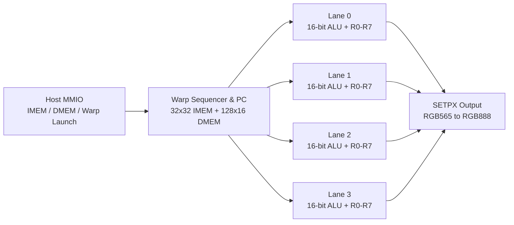

# nk-simt-gpu (`nk_gpu_top`)

A custom **4-lane SIMT virtual GPU** written from scratch in Verilog-2001, verified with **Cocotb 1.9.2** dual-simulator regression (Icarus Verilog 12.0 & Verilator 5.020), and hardened to **ASAP7 7 nm FinFET GDSII** using OpenROAD-flow-scripts.

## Silicon Layout & Shader Output

| ASAP7 7 nm GDSII (`nk_gpu_top`) | Hardware Shader Output (`32×32` RGB) |
| :---: | :---: |
| [assets/nk_gpu_top.png] | [tb/nk_gpu_render.png] |

## Architecture



- **ISA & Datapath:** 32-bit fixed-width instruction word, 16-bit 4-lane SIMT execution (`MOVI`, `ADD`, `SUB`, `MUL`, `ADDI`, `AND`, `OR`, `SHR`, `SHL`, `LD`, `ST`, `SETPX`, `HALT`).
- **Registers:** `R0` = zero, `R1` = `LANE_ID` (`0..3`), `R2` = `warp_id`, `R3..R7` = per-lane 16-bit GPRs.
- **Memories:** `32 × 32-bit` instruction memory (`imem`) and `128 × 16-bit` shared data memory (`dmem`).

## ASAP7 7 nm Signoff Metrics (`openroad/orfs`)

| Metric | Value |
| :--- | :--- |
| **Target Clock** | `1500.0 ps` (`666.7 MHz`) |
| **Achieved Frequency (Post-Route)** | `652.4 MHz` (`1532.84 ps`, WNS `-32.84 ps`, TNS `-540.63 ps`) |
| **Setup Clock Skew** | `23.78 ps` |
| **Die / Core Area** | `128.79 × 128.79 µm` (`16,586.35 µm²` die / `16,048.83 µm²` core) |
| **Active Cell Area / Utilization** | `5,462 µm²` / `34%` |
| **Instance Count** | `51,430` pre-fill (`127,372` post-fill) |
| **Routed Wirelength / Vias** | `303,080 µm` / `562,975` vias |
| **Total Power (`0.77 V`)** | `10.9 mW` |
| **Worst-Case IR Drop** | `2.28 mV` (`0.30%` VDD) / `2.22 mV` (`0.29%` VSS) |
| **DRC / Antenna / LEC** | `0` DRC / `0` Antenna / **PASS** |

## Verification (`Cocotb 1.9.2`)

- `test_simt_vector_mac_kernel`: `C[i] = A[i] * B[i] + D[i]` across 4 warps (16 threads) — **PASS**
- `test_virtual_gpu_shader_render`: `32×32` RGB shader rendered on RTL and exported to `tb/nk_gpu_render.png` — **PASS**
- Both Icarus Verilog 12.0 and Verilator 5.020 pass `2/2` (`10,244 ns`).

## Quickstart

```bash
# Cocotb dual-sim regression
make -C tb SIM=icarus
make -C tb SIM=verilator

# ASAP7 7 nm RTL-to-GDSII (OpenROAD-flow-scripts)
docker run --rm -v "$PWD":/work -w /OpenROAD-flow-scripts/flow openroad/orfs:latest \
  make DESIGN_CONFIG=/work/orfs/config.mk WORK_HOME=/work/orfs/build
```
