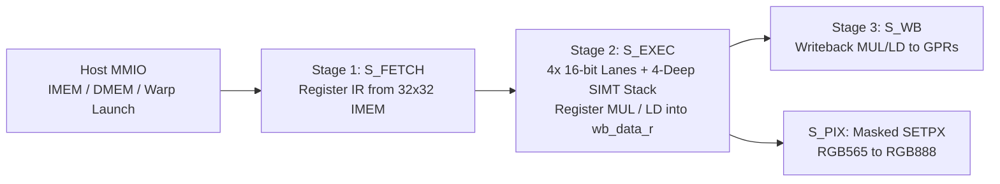

# nk-simt-gpu (`nk_gpu_top`)

A custom **4-lane SIMT virtual GPU** written from scratch in Verilog-2001 with a **3-stage `FETCH → EXEC → WB` pipeline (`1.020 GHz` post-route Fmax)**, **hardware loops (`JMP`/`BEQ`/`BNE`/`BLT`)**, and **per-lane divergence/reconvergence (`IF_EQ`/`IF_LT`/`ELSE`/`ENDIF` + 4-deep mask stack)**, verified with **19/19 Cocotb 1.9.2** dual-simulator tests and hardened to **ASAP7 7 nm FinFET GDSII** with **`WNS = 0.00 ps`**.

## Silicon Layout & Shader Outputs

| ASAP7 7 nm GDSII (`nk_gpu_top` `v2.0.0`) | Gradient Shader (`32×32`) | Divergent Orb Shader (`32×32`) |
| :---: | :---: | :---: |
| [assets/nk_gpu_top.png] | [tb/nk_gpu_render.png] | [tb/nk_gpu_divergent.png] |

## Architecture (`v2.0.0` 3-Stage Pipeline)



- **ISA & Datapath:** 32-bit fixed-width instruction word, 16-bit 4-lane SIMT execution (`NOP`, `MOVI`, `ADD`, `SUB`, `MUL`, `ADDI`, `AND`, `OR`, `SHR`, `SHL`, `LD`, `ST`, `SETPX`, `BR`: `JMP`/`BEQ`/`BNE`/`BLT`, `SIMT`: `IF_EQ`/`IF_LT`/`ELSE`/`ENDIF`, `HALT`).
- **Registers:** `R0` = zero, `R1` = `LANE_ID` (`0..3`), `R2` = `warp_id`, `R3..R7` = per-lane 16-bit GPRs.
- **Memories:** `32 × 32-bit` instruction memory (`imem`) and `128 × 16-bit` shared data memory (`dmem`).

## ASAP7 7 nm Signoff Progression (`openroad/orfs`)

| Metric | `v1.0.0` | `v1.1.0` | `v1.2.0` (SIMT Branch) | `v2.0.0` (3-Stage 1 GHz) |
| :--- | :--- | :--- | :--- | :--- |
| **Target Clock** | `1500 ps` (`667 MHz`) | `1600 ps` (`625 MHz`) | `1600 ps` (`625 MHz`) | **`1000 ps` (`1.00 GHz`)** |
| **Worst Slack / WNS / TNS** | `-32.84 ps` / `-32.84` / `-540.6` | `+157.12 ps` / `0.00` / `0.00` | `+139.58 ps` / `0.00` / `0.00` | **`+19.22 ps` / `0.00` / `0.00`** |
| **Achieved Fmax (Post-Route)** | `652.4 MHz` | `693.1 MHz` | `684.7 MHz` | **`1.020 GHz` (`980.78 ps`)** |
| **Setup Clock Skew** | `23.78 ps` | `24.37 ps` | `22.97 ps` | **`21.70 ps`** |
| **Die Area** | `128.8 × 128.8 µm` | `128.8 × 128.8 µm` | `130.1 × 130.1 µm` | `136.2 × 136.2 µm` (`18,548 µm²`) |
| **Active Cell Area / Util** | `5,462 µm²` / `34%` | `5,469 µm²` / `34%` | `5,543 µm²` / `34%` | **`5,342 µm²`** / `30%` |
| **Post-Fill Instance Count** | `127,372` | `127,278` | `128,600` | `128,044` |
| **Routed Wirelength / Vias** | `303,080 µm` / `562,975` | `303,885 µm` / `564,267` | `297,988 µm` / `562,762` | `347,096 µm` / `576,169` |
| **Total Power (`0.77 V`)** | `10.9 mW` | `10.4 mW` | `11.5 mW` | `15.8 mW` |
| **Worst-Case IR Drop** | `0.30%` / `0.29%` | `0.22%` / `0.24%` | `0.26%` / `0.18%` | `0.42%` VDD / `0.38%` VSS |
| **DRC / Antenna / LEC** | `0` / `0` / **PASS** | `0` / `0` / **PASS** | `0` / `0` / **PASS** | `0` / `0` / **PASS** |

## Verification (`19/19` Cocotb Dual-Sim + Golden Model)

- **`driver/nk_gpu_golden.py` & `driver/nk_gpu_kernels.py`**: Bit-exact 16-bit SIMT reference model, `build_divergent_orb_shader()`, and `build_matvec4_kernel()`.
- **19/19 Dual-Sim Tests PASS (`130,376 ns` on Icarus Verilog 12.0 & Verilator 5.020):** Vector MAC, `32×32` gradient & divergent orb shaders, `4×4` `BLT` matvec, directed ISA corner cases, 20-program SIMT fuzzer, 80-program random regression, and strict functional coverage + Verilator RTL coverage in CI.

## Quickstart

```bash
# Cocotb dual-sim regression + Verilator RTL coverage
make -C tb SIM=icarus
make -C tb SIM=verilator VERILATOR_COVERAGE=1

# ASAP7 7 nm RTL-to-GDSII (OpenROAD-flow-scripts)
docker run --rm -v "$PWD":/work -w /OpenROAD-flow-scripts/flow openroad/orfs:latest \
  make DESIGN_CONFIG=/work/orfs/config.mk WORK_HOME=/work/orfs/build
```
