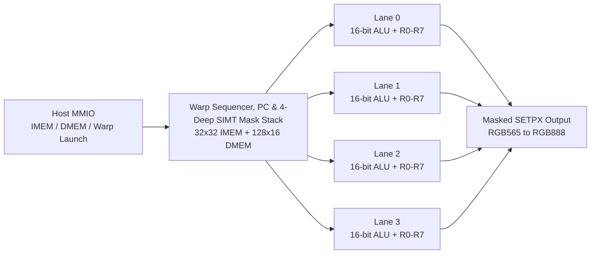

# nk-simt-gpu (`nk_gpu_top`)

A custom **4-lane SIMT virtual GPU** written from scratch in Verilog-2001 with **hardware loops (`JMP`/`BEQ`/`BNE`/`BLT`) and per-lane divergence/reconvergence (`IF_EQ`/`IF_LT`/`ELSE`/`ENDIF` + 4-deep mask stack)**, verified with **17/17 Cocotb 1.9.2** dual-simulator tests (Icarus Verilog 12.0 & Verilator 5.020 + 92% RTL coverage + Python golden model), and hardened to **ASAP7 7 nm FinFET GDSII** with **clean timing closure (`WNS = 0.00 ps`, `+139.58 ps` slack)**.

## Silicon Layout & Shader Output

| ASAP7 7 nm GDSII (`nk_gpu_top` `v1.2.0`) | Hardware Shader Output (`32×32` RGB) |
| :---: | :---: |
| [assets/nk_gpu_top.png] | [tb/nk_gpu_render.png] |

## Architecture



- **ISA & Datapath:** 32-bit fixed-width instruction word, 16-bit 4-lane SIMT execution (`NOP`, `MOVI`, `ADD`, `SUB`, `MUL`, `ADDI`, `AND`, `OR`, `SHR`, `SHL`, `LD`, `ST`, `SETPX`, `BR`: `JMP`/`BEQ`/`BNE`/`BLT`, `SIMT`: `IF_EQ`/`IF_LT`/`ELSE`/`ENDIF`, `HALT`).
- **Registers:** `R0` = zero, `R1` = `LANE_ID` (`0..3`), `R2` = `warp_id`, `R3..R7` = per-lane 16-bit GPRs.
- **Memories:** `32 × 32-bit` instruction memory (`imem`) and `128 × 16-bit` shared data memory (`dmem`).

## ASAP7 7 nm Signoff Progression (`openroad/orfs`)

| Metric | `v1.0.0` (1500 ps) | `v1.1.0` (1600 ps, Closed) | `v1.2.0` (SIMT Branch + Mask Stack) |
| :--- | :--- | :--- | :--- |
| **Target Clock** | `1500.0 ps` (`666.7 MHz`) | `1600.0 ps` (`625.0 MHz`) | `1600.0 ps` (`625.0 MHz`) |
| **Worst Slack / WNS / TNS** | `-32.84 ps` / `-32.84 ps` / `-540.63 ps` | `+157.12 ps` / `0.00 ps` / `0.00 ps` | **`+139.58 ps` / `0.00 ps` / `0.00 ps`** |
| **Achieved Fmax (Post-Route)** | `652.4 MHz` (`1532.84 ps`) | `693.1 MHz` (`1442.88 ps`) | **`684.7 MHz` (`1460.42 ps`)** |
| **Setup Clock Skew** | `23.78 ps` | `24.37 ps` | **`22.97 ps`** |
| **Die Area** | `128.79 × 128.79 µm` | `128.79 × 128.79 µm` | `130.05 × 130.05 µm` (`16,913.26 µm²`) |
| **Active Cell Area / Util** | `5,462 µm²` / `34%` | `5,469 µm²` / `34%` | `5,543 µm²` / `34%` |
| **Post-Fill Instance Count** | `127,372` | `127,278` | `128,600` |
| **Routed Wirelength / Vias** | `303,080 µm` / `562,975` | `303,885 µm` / `564,267` | **`297,988 µm` / `562,762`** |
| **Total Power (`0.77 V`)** | `10.9 mW` | `10.4 mW` | `11.5 mW` |
| **Worst-Case IR Drop** | `0.30%` VDD / `0.29%` VSS | `0.22%` VDD / `0.24%` VSS | `0.26%` VDD / `0.18%` VSS |
| **DRC / Antenna / LEC** | `0` DRC / `0` Ant / **PASS** | `0` DRC / `0` Ant / **PASS** | `0` DRC / `0` Ant / **PASS** |

## Verification (`17/17` Cocotb Dual-Sim + Golden Model)

- **`driver/nk_gpu_golden.py`**: Bit-exact 16-bit 4-lane SIMT reference model with active-mask stack & functional coverage.
- **17/17 Dual-Sim Tests PASS (`108,692 ns` on Icarus Verilog 12.0 & Verilator 5.020):**
  - `test_nk_gpu.py` (7 tests): Vector MAC kernel, `32×32` RGB shader, directed ISA corner cases, 20-program constrained-random SIMT fuzzer, MMIO busy guard, nested SIMT divergence (`IF_LT`/`IF_EQ`/`ELSE`/`ENDIF` + masked `SETPX`), and in-kernel hardware loop (`BLT`/`BEQ`).
  - `test_nk_gpu_verif.py` (10 tests): ALU/shift/special-reg/memory/SETPX protocol directed suites, reset-during-run, 80-program random regression, and strict functional coverage gate.

## Quickstart

```bash
# Cocotb dual-sim regression + Verilator RTL coverage
make -C tb SIM=icarus
make -C tb SIM=verilator VERILATOR_COVERAGE=1

# ASAP7 7 nm RTL-to-GDSII (OpenROAD-flow-scripts)
docker run --rm -v "$PWD":/work -w /OpenROAD-flow-scripts/flow openroad/orfs:latest \
  make DESIGN_CONFIG=/work/orfs/config.mk WORK_HOME=/work/orfs/build
```
