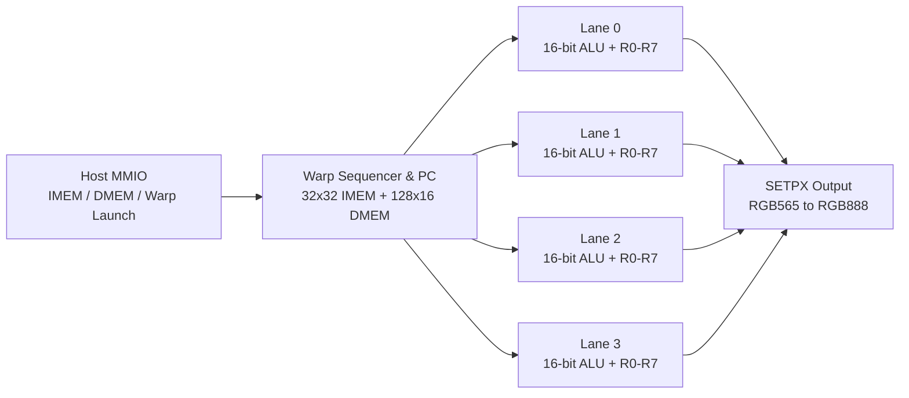

# nk-simt-gpu (`nk_gpu_top`)

A custom **4-lane SIMT virtual GPU** written from scratch in Verilog-2001, verified with **Cocotb 1.9.2** dual-simulator regression (Icarus Verilog 12.0 & Verilator 5.020 + 87.00% RTL coverage + Python golden model), and hardened to **ASAP7 7 nm FinFET GDSII** using OpenROAD-flow-scripts with **clean timing closure (`WNS = 0.00 ps`, `+157.12 ps` slack)**.

## Silicon Layout & Shader Output

| ASAP7 7 nm GDSII (`nk_gpu_top`) | Hardware Shader Output (`32×32` RGB) |
| :---: | :---: |
| [assets/nk_gpu_top.png] | [tb/nk_gpu_render.png] |

## Architecture



- **ISA & Datapath:** 32-bit fixed-width instruction word, 16-bit 4-lane SIMT execution (`NOP`, `MOVI`, `ADD`, `SUB`, `MUL`, `ADDI`, `AND`, `OR`, `SHR`, `SHL`, `LD`, `ST`, `SETPX`, `HALT`).
- **Registers:** `R0` = zero, `R1` = `LANE_ID` (`0..3`), `R2` = `warp_id`, `R3..R7` = per-lane 16-bit GPRs.
- **Memories:** `32 × 32-bit` instruction memory (`imem`) and `128 × 16-bit` shared data memory (`dmem`).

## ASAP7 7 nm Signoff Metrics (`openroad/orfs`)

| Metric | `v1.0.0` (1500 ps) | `v1.1.0` (1600 ps, Closed) |
| :--- | :--- | :--- |
| **Target Clock** | `1500.0 ps` (`666.7 MHz`) | `1600.0 ps` (`625.0 MHz`) |
| **Worst Slack / WNS / TNS** | `-32.84 ps` / `-32.84 ps` / `-540.63 ps` | **`+157.12 ps` / `0.00 ps` / `0.00 ps`** |
| **Achieved Fmax (Post-Route)** | `652.4 MHz` (`1532.84 ps`) | **`693.1 MHz` (`1442.88 ps`)** |
| **Setup Clock Skew** | `23.78 ps` | `24.37 ps` |
| **Die / Core Area** | `128.79 × 128.79 µm` (`16,586.35 µm²`) | `128.79 × 128.79 µm` (`16,586.35 µm²`) |
| **Active Cell Area / Utilization** | `5,462 µm²` / `34%` | `5,469 µm²` / `34%` |
| **Post-Fill Instance Count** | `127,372` | `127,278` |
| **Routed Wirelength / Vias** | `303,080 µm` / `562,975` vias | `303,885 µm` / `564,267` vias |
| **Total Power (`0.77 V`)** | `10.9 mW` | **`10.4 mW`** |
| **Worst-Case IR Drop** | `0.30%` VDD / `0.29%` VSS | **`0.22%` VDD / `0.24%` VSS** |
| **DRC / Antenna / LEC** | `0` DRC / `0` Antenna / **PASS** | `0` DRC / `0` Antenna / **PASS** |

## Verification (`Cocotb 1.9.2` + Golden Model)

- **`driver/nk_gpu_golden.py`**: Bit-exact 16-bit 4-lane SIMT golden model + functional coverage tracker.
- **5/5 Dual-Sim Tests PASS (`26,480 ns` on Icarus Verilog 12.0 & Verilator 5.020):**
  - `test_simt_vector_mac_kernel`: `C[i] = A[i] * B[i] + D[i]` across 4 warps (16 threads).
  - `test_virtual_gpu_shader_render`: `32×32` RGB shader rendered on RTL and exported to `tb/nk_gpu_render.png`.
  - `test_directed_isa_corner_cases`: All 14 opcodes, 16-bit overflow/underflow, shifts by 0 and 15, read-only `R0..R2` protection, 7-bit `dmem` wrap, and `SETPX` RGB565→RGB888.
  - `test_constrained_random_simt_fuzz`: 20 randomized multi-warp programs checked against the golden model (**14/14 opcodes**, **8/8 registers**, **9/9 corner cases**).
  - `test_mmio_guard_while_busy`: Verifies `host_we` writes are ignored while `gpu_busy=1`.
- **Verilator RTL Coverage:** `87.00%` (`104/119`), uploaded in CI.

### Golden-model & coverage-driven regression (`tb/test_nk_gpu_verif.py`)

- **Golden model** (`tb/nk_gpu_model.py`): Python reference of the full ISA; after every launch the DUT's full DMEM, SETPX pixel stream and status word are compared against it.
- **Directed tests:** ALU corner cases (carry, borrow, overflow), all 16 shift amounts, special registers R0/R1/R2, DMEM address wrap and same-address lane conflicts, SETPX protocol and RGB565→RGB888, NOP/undefined opcodes, host interface (busy lock-out, sticky done), reset mid-run.
- **Constrained-random:** `NK_RAND_PROGRAMS` programs × 2 launches per seed (`NK_SEED`), with corner-biased operands and warp IDs.
- **Functional coverage** (`tb/nk_gpu_cov.py`): 92 required bins (opcodes, registers, shift amounts, arithmetic corners, memory wrap/conflict, SETPX, warp-ID classes) — the regression fails if any bin is missed.
- **Result:** `12/12` tests pass on Icarus and Verilator, `92/92` bins covered; 5 of 6 injected RTL bugs are caught (the sixth is an equivalent mutant).

```bash
NK_SEED=7 NK_RAND_PROGRAMS=200 make -C tb SIM=icarus MODULE=test_nk_gpu_verif
```

## Quickstart

```bash
# Cocotb dual-sim regression + Verilator RTL coverage
make -C tb SIM=icarus
make -C tb SIM=verilator VERILATOR_COVERAGE=1

# ASAP7 7 nm RTL-to-GDSII (OpenROAD-flow-scripts)
docker run --rm -v "$PWD":/work -w /OpenROAD-flow-scripts/flow openroad/orfs:latest \
  make DESIGN_CONFIG=/work/orfs/config.mk WORK_HOME=/work/orfs/build
```
